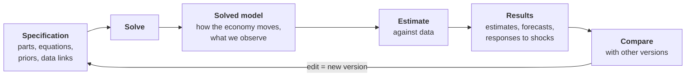
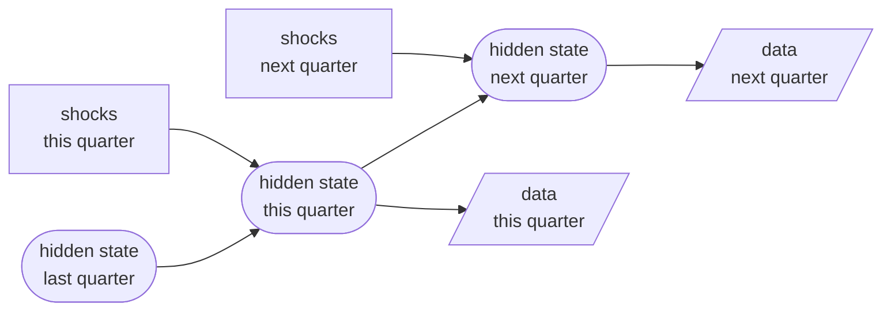
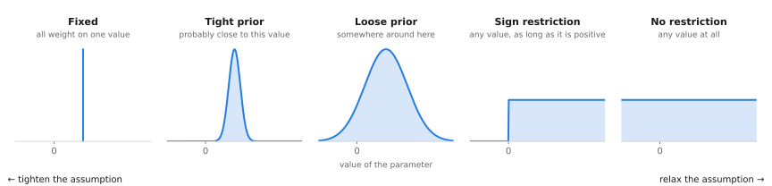
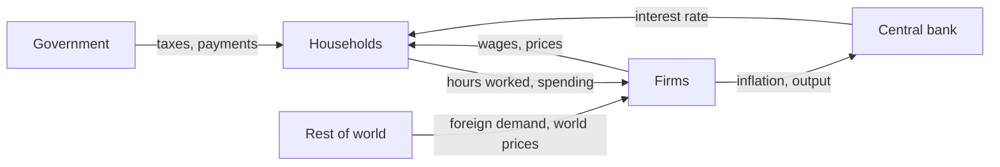
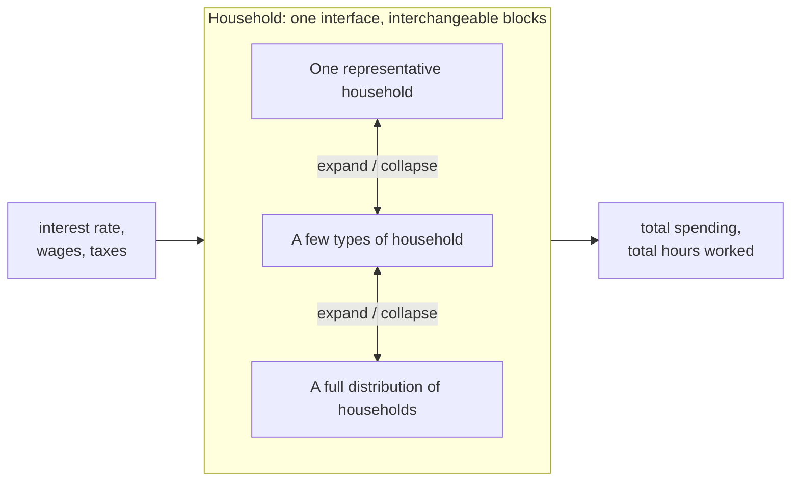
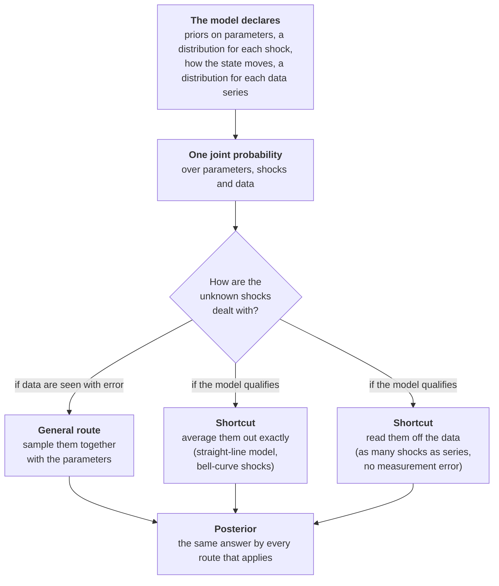

# mutatis

A laboratory for economic models. Write a model down, estimate it on data, then change one assumption and see what difference the change made.

> **Status: under construction.** The foundations are built and the first demonstration is in progress; see [PLAN.md](PLAN.md) for what is done and what is next. This document describes what mutatis is: the concepts and the framework choices. Parts marked *proposed*, and everything under [Open questions](#open-questions), are not settled.

## What it is for

Economic models are usually built once, by hand, and are then expensive to change. Swapping one assumption (say, one household for many types of household) can mean months of work, a different solution method, and new estimation code. So most assumptions never get tested against their alternatives.

mutatis aims to make that kind of change cheap. A model is a set of parts. You can:

- **expand** a part: relax an assumption, e.g. replace the single household with several household types, or replace fully rational expectations with something weaker;
- **collapse** a part back to a simpler form;
- **add or remove** a part, e.g. a government or a foreign sector;
- **add data** the model has to fit, with a stated error distribution;
- **add a prior or a restriction** on a parameter, or on how the model behaves.

After each change the model is re-solved and re-estimated, and the old and new versions are compared side by side.



The motivating example is the Australian economy: start from a standard small macro model, then expand and constrain it step by step.

The aim is breadth with a common structure. A structural vector autoregression (SVAR, a statistical model of several time series with restrictions that give its shocks an economic meaning) and a dynamic stochastic general equilibrium model (DSGE, a model built from the decisions of households, firms and policy makers) should both be expressible, estimated by the same machinery, and comparable with each other.

## Core ideas

### 1. Every solved model has the same shape

Almost every model in scope, once solved, comes down to two rules:

- **how the economy moves:** `state[t] = f(state[t-1], shocks[t], parameters)`
- **what we observe:** `data[t] = g(state[t], parameters)`, seen with some measurement error

This shape is called a **state-space model**. The *state* is everything the model needs to know about the economy at one date; much of it is hidden (nobody observes the output gap directly). The *shocks* are random disturbances that hit each period. The *parameters* are fixed numbers such as how patient households are.



This is the common currency of mutatis. Everything downstream of solving (estimation, forecasting, responses to shocks) reads only this form. Model families differ only in how they get there:

- A VAR already has this shape. Nothing needs solving.
- A DSGE does not. Its equations contain what people expect about the future, so they must be solved first (see [Solving](#solving)). The solution has this shape.

Nothing in this shape requires the rules to be straight lines or the shocks to follow a bell curve. Those are properties of particular models, not of the framework.

### 2. Equations are the building material, not agents taking turns

It is tempting to build a model from agents that each take a step every period. That works when agents only look backward. It does not work for forward-looking models: households decide today based on what they expect tomorrow, and tomorrow depends on what everyone decides today. Nobody can go first. The model is a set of equations that must all hold at once.

So in mutatis a part of a model contributes **equations**, and the step-forward rule is something the solver produces. Models where agents really do just take turns (backward-looking models, simulations) are the easy special case.

### 3. Assumptions, restrictions and priors are the same thing at different strengths

A prior is a statement of what you believe about a parameter before seeing the data. mutatis treats every assumption as a prior of some strength.



| What it is usually called | What it is in mutatis |
|---|---|
| A calibrated (fixed) parameter | A prior with all its weight on one value |
| A zero restriction in an SVAR | The same: all weight on zero |
| A sign restriction | No weight on the wrong sign. This rules values out, but does not say how belief is spread over the values that remain (see below) |
| An ordinary prior | A prior |
| "Let the data speak" | A very wide prior |
| A structural model imposed on the data | A prior that holds a flexible statistical model close to the structural one |

"Tightening" and "relaxing" an assumption are then one operation: changing how strong a prior is. That is what the name refers to.

The last row is worth spelling out. A DSGE can be used as a prior on a VAR, with a single weight that says how tightly the VAR is held to the DSGE (Del Negro & Schorfheide, 2004). A very large weight gives the DSGE; a weight near zero gives an unrestricted VAR. The weight can itself be estimated, which tells you how much of the structural model the data will tolerate.

**Restrictions that only rule values out.** A fixed value is a complete prior. A sign restriction is not: it says where the weight cannot be, and nothing about how the weight is spread over what remains. Usually that gap does not matter, because the data fill it in. It matters when the data cannot tell the remaining values apart at all, which is the situation in an SVAR with sign restrictions. Then there are two honest options, and mutatis offers both:

- choose a spread, which makes it an ordinary prior, shown as an assumption like any other;
- choose none, and report the **range** of answers across every spread that respects the restriction.

See [When the data cannot decide](#when-the-data-cannot-decide).

### 4. Say what the model is; the method follows

A mutatis model states what is assumed: the equations, the priors, how each kind of shock is distributed, how each data series relates to the model. It does not state how to estimate it.

This is the central design problem: be general enough that almost any assumption can be changed, while still estimating efficiently. The answer adopted here is a general method that always applies, plus faster methods that are used automatically whenever a model happens to qualify for them (see [Estimation](#estimation)). No fast method is allowed to dictate what a model may assume.

Where generality and speed conflict, **generality wins**. A change of assumption must never be ruled out because a particular algorithm cannot handle it. Some speed is given up for that.

### 5. Every edit is a new version, and comparison is the point

A model is a document. An edit produces a new version. Each version keeps its own estimation results. Versions can be compared: what changed in the specification, and what changed in the parameter estimates, the fit, the forecasts and the responses to shocks.

Good solvers and estimators already exist (see [Prior art](#prior-art)). What does not exist in a polished form, as far as we know, is this change-and-compare workflow. That is where mutatis is meant to contribute.

## The five layers

1. **Structure.** The model as a set of connected parts. This is what the web app draws.
2. **Solve.** Turns the structure into a solved model: a rule for how the economy moves. Which solver is needed depends on the model.
3. **Measure.** Links model variables to data series: which series observes which variable, how the series is transformed (growth rates, per-person terms), how its measurement error is distributed, and how missing values and mixed frequencies (monthly data in a quarterly model) are handled.
4. **Infer.** Combines the solved model, the data and the priors into estimates.
5. **Compare.** Stores results per version and shows the differences between versions.

**Time is discrete**, with the quarter as the default period. Data are discrete, and almost all estimated work of this kind is too. Mixed frequencies are handled in the measure layer.

## Building blocks

**Block.** One part of the economy: a household, a firm, a central bank, a government, the rest of the world. A block declares its variables, parameters, shocks and equations, and states what it takes in and what it gives out. There is one kind of thing here, not separate "agents" and "components". Whether a block comes from someone optimising (a household choosing consumption) or from a simple rule (a central bank's interest-rate rule) is a property of the block.

**Connections.** Blocks are joined by shared variables and by conditions that markets clear (what is supplied equals what is demanded). Blocks and connections form a graph:



**Interface.** The variables a block takes in and gives out. This is what makes expanding and collapsing well defined. Blocks with the same interface are interchangeable: expanding the household means swapping in a richer block behind the same interface, and collapsing means swapping back.



Expansions come from a curated library of blocks, not from automatic generation. "Make households differ" involves real choices (how many types, what incomes they face, how much they can borrow) that a click cannot make by itself.

**Indexed variables.** A variable can run over a set: consumption over goods, households over types, prices over industries. Splitting consumption into twenty goods should mean changing a set, not writing every equation twenty times.

**Expectation terms.** Wherever an equation contains "what people expect x to be next period", that term is explicitly marked. A model-wide setting then decides how marked terms are computed: fully rational (consistent with the model itself), adaptive (based on the past), taken from a small statistical forecasting model, or rational but with the future discounted (Gabaix, 2020). This is how "relax rational expectations" becomes a switch and not a rewrite. The Federal Reserve's FRB/US model has a similar switch.

**Shocks.** The random disturbances. Each has a declared distribution: how large disturbances of that kind usually are, and how often very large ones occur. The bell curve is the usual choice, not a requirement. A model needs at least as many shocks and measurement errors as it has observed data series; otherwise it claims some combination of the data is exactly predictable, which real data never is.

**Data links.** A data series attached to a model variable, with a transformation and an error distribution. "This series stayed between x and y" is also a data link, with a different error distribution.

**Priors.** On parameters, as in core idea 3. Also on model behaviour: "the peak effect of an interest-rate rise on inflation is between x and y" is a prior on something the model implies, not on any one parameter (Andrle & Beneš, 2013).

## Writing a model down

*Proposed. See [Open questions](#open-questions).*

The stored form of a model is a **declarative specification**: a document that says what the model is, not a program that computes it. The rest of the design depends on this. The web app must be able to display and edit the model; versions must be comparable line by line; and a web app must not run arbitrary code that a user typed in.

- The specification is YAML (the same structure can be stored as JSON for the web app).
- Equations are written as text in ordinary mathematical notation, read by a small parser. Because the system sees the equations as symbols, it can display them as mathematics, count equations against unknowns, find the expectation terms, and take derivatives.
- Some blocks cannot be written as a few equations. A many-household block has to solve each household's decision problem numerically. Such a block is written as code (a JAX function) and registered under a name. The specification refers to it by name and still declares its interface, parameters and priors. In the web app it appears as a box whose connections can be inspected and changed but whose insides cannot.
- People who prefer writing Python can build a model with a Python interface. That interface produces the same specification document; it is a second way of writing one, not a second kind of model.

A sketch, to show the flavour only. This is not final syntax.

```yaml
model: small-new-keynesian
time: quarterly

blocks:
  household:
    inputs:  [i, pi]      # interest rate, inflation
    outputs: [c]          # consumption
    parameters:
      beta:  {fixed: 0.99}                      # an assumption: all weight on one value
      sigma: {prior: gamma(mean=1.5, sd=0.4)}   # a belief the data can update
    equations:
      - c**(-sigma) = beta * E(c(+1)**(-sigma) * (1 + i) / (1 + pi(+1)))

  central_bank:
    inputs:  [pi]
    outputs: [i]
    parameters:
      phi: {prior: normal(mean=1.5, sd=0.25)}
    shocks:
      eps_i: normal            # could be student_t: rare large surprises
    equations:
      - i = i_steady + phi * pi + eps_i

data:
  - series: trimmed_mean_cpi
    observes: pi
    transform: quarterly_log_change
    error: normal(sd=0.1)
```

Here `c(+1)` is consumption next period and `E(...)` marks an expectation term. Relaxing the assumption on `beta` means replacing `fixed` with a `prior`. Expanding the household means pointing `household` at a different block with the same inputs and outputs. Allowing for rare large interest-rate surprises means changing one word in `shocks`.

## Solving

"Solving" means turning the model's equations into the rule for how the economy moves. Different models need different solvers, and solvers are interchangeable parts. The kinds needed:

| Solver | What it is for |
|---|---|
| None | Models that are already a step-forward rule: VARs, backward-looking models |
| Steady state | Finding the resting point of the economy, where nothing changes unless a shock hits. Most other solvers start from it |
| Linear, forward-looking | The most widely used. Approximates the model by straight lines around the steady state and solves for the one path that does not explode. Also reports when there is no such path or more than one (the Blanchard–Kahn conditions) |
| Whole path | Solves many future periods jointly. For scenarios with known future events: an announced policy, an imposed interest-rate path, interest rates stuck at zero |
| Many households or firms | Tracks a whole distribution of households or firms, along the lines of the sequence-space Jacobian method (Auclert, Bardóczy, Rognlie & Straub, 2021) |
| Nonlinear with uncertainty | For models where the straight-line approximation is not good enough |
| Simulation only | For models that can be run but not solved, such as agent-based models; see [Which models fit](#which-models-fit) |

Whatever the solver, what it hands on is the same thing: a rule that can **step** the economy forward one period given the shocks. Optionally it can also **solve a whole path under conditions**, which is what scenarios use.

On forecasting: for a forward-looking model, the future is taken into account when the model is solved, once per set of parameter values. After that, forecasting is just stepping forward, the same as for a VAR. Solving for a whole future path is only needed for scenarios with known future events.

## Estimation

### A model is a probability statement

A complete mutatis model states four things:

1. a prior for each parameter;
2. a distribution for each shock;
3. how the state moves, given last period's state and this period's shocks;
4. a distribution for each data series, given the state.

Together these define one joint probability over parameters, shocks and data. Estimation asks a single question of it: given the data actually observed, which parameter values and which histories of shocks are plausible? The answer is called the **posterior**. No estimation method appears anywhere in that definition.

This is why the framework is Bayesian. Since every assumption is a prior of some strength (core idea 3), the natural result of estimation is what the data did to those priors.

The shocks are unknowns too, one value per shock per period. Their declared distribution is the prior on them, and it does real work. A model with enough shocks can reproduce any data exactly, whatever its parameters. What separates a good parameter value from a bad one is whether the shocks it needs look like draws from the declared distribution (modest, with no pattern), or whether the shocks are doing the work the model should be doing.

### Computing the answer



**The general route** treats the shocks as unknowns alongside the parameters and samples both together, using gradients. It works for any rule of motion and any distributions that can be evaluated and differentiated: bell-curve or fat-tailed shocks, straight-line or curved models, range-only observations (Childers et al., 2022, estimate DSGE models this way). It defines what the right answer is.

It needs the data to be seen with some error. When a series is observed exactly, the shocks behind it are fixed by the data: there is nothing left to sample, and they have to be read off the data instead. A VAR is the standard case, where every series is observed exactly and the shocks are the model's one-step-ahead errors. A model that mixes the two cases reads off the shocks fixed by exact observations and samples the rest.

**Shortcuts** give the same answer faster for models with special structure:

| When the model has this structure | The shocks can be |
|---|---|
| As many shocks as data series, no measurement error (a VAR) | Read off the data directly; they are the model's one-step-ahead errors |
| The state moves in straight lines, and shocks and measurement errors follow bell curves | Averaged out exactly, period by period, by the Kalman filter. This also gives an estimate of the hidden state at every date |

Shortcuts are chosen automatically, never by the person writing the model. If an edit removes the special structure (say, one shock is given fat tails), the shortcut stops applying and the general route takes over. The edit is still allowed and the results are still comparable with the version before. Where a shortcut and the general route both apply they must agree, which also gives a standing test of both.

The Kalman filter is the standard tool in this field, and for many models it will be the route actually taken. But it is an optimisation of one case, not part of the definition of the framework.

**Models that can only be simulated** fall outside both of the above. Their step is a program that makes a very large number of internal random draws and reports only a few totals. Take an agent-based labour market with 10,000 households. Each quarter the program draws which workers lose their jobs, which job-seekers meet which firms, and which meetings end in a hire. Then it reports one number, the unemployment rate. The probability of that reported rate has no formula: it would mean adding up over every combination of individual outcomes that gives the same rate.

In principle the general route still applies: treat every internal draw as an unknown. In practice it does not, for three reasons. There are millions of such draws, not about a thousand. Many of them are yes-or-no events, which have no gradient. And the rules that link them (thresholds, sorting, matching) are not smooth. A simulation with only a few continuous random inputs has none of these problems, and goes through the general route like any other model.

The true cases need the internal randomness averaged out by running many simulated copies side by side (a particle filter), or estimation by matching summary statistics. See [Which models fit](#which-models-fit).

**The contract between a model and its estimation** is deliberately narrow: the logarithm of the prior and the logarithm of the likelihood, as two separate functions of the unknowns with exact derivatives, a way to draw the unknowns from the prior, and a description of which unknown is which. The two densities are kept apart because bringing the data in gradually needs them separately. When shocks are sampled they are among the unknowns. Anything that can estimate from such a description can be plugged in.

### What the sampler has to do

The sampler is the algorithm that draws from the posterior. No particular one is fixed. It has to meet four requirements:

1. **Cope with several peaks and long flat ridges.** These posteriors often have them (Canova & Sala, 2009; Herbst & Schorfheide, 2014). The most common workflow in the field finds one peak and samples around it, and so can miss the others. For a tool built on comparing versions this matters more than usual: if version A lands on one peak and version B on another, the comparison shows a difference that came from the search, not from the change.
2. **Produce the marginal likelihood,** the overall probability of the data under a version. It is the standard basis for comparing versions (but see [Open questions](#open-questions)).
3. **Use gradients,** because the general route involves hundreds or thousands of unknowns.
4. **Run in parallel.**

Sequential Monte Carlo is the leading candidate. It starts with thousands of draws spread across the whole prior and brings in the data gradually, so the draws settle wherever the posterior has weight; its internal moves can use gradients; and it gives the marginal likelihood as a by-product.

A quick first look (find a peak, approximate the posterior around it) is useful for fast feedback, provided it is labelled as such.

### When the data cannot decide

Some unknowns are ones the data say nothing about, however much data there is. The standard case is an SVAR. The data pin down how the series move together and how large the forecast errors are. They do not pin down how to split those errors into separate economic shocks: many different splits fit the data exactly equally well. Sign restrictions rule some splits out. Among the splits that remain, the data have no preference.

For such an unknown, the posterior is simply the prior, untouched by the data. Whatever spread was assumed across the allowed splits passes straight through into the results (Baumeister & Hamilton, 2015). Under the conventional choice of spread, a reported "most likely" effect partly reflects that choice and not the data.

mutatis therefore lets such an unknown carry a restriction with no prior behind it. Results are then reported as ranges, in three steps:

1. Sample everything the data *can* learn, by the ordinary route.
2. For each draw, find the smallest and the largest value of the quantity of interest across everything the restrictions allow.
3. Report the range: "the average effect lies between x and y", together with an interval that holds whichever spread is assumed.

Step 2 is a search for bounds, not sampling, so it is a separate computation that sits on top of the ordinary route. The approach is still Bayesian: one prior for what the data can learn, and every possible prior for what they cannot (Giacomini & Kitagawa, 2021). Read (2022) applies it to the effects of monetary policy in Australia.

Two things to be clear about:

- More data sharpen step 1 but never shrink the range to a point. Only more restrictions do that.
- This only makes sense for unknowns the data cannot inform. For anything the data can inform, ranging over every possible prior would say nothing, because a stubborn enough prior can produce any answer. So it is offered where the two kinds of unknown separate cleanly, as they do in an SVAR.

### Models not usually thought of as Bayesian

These fit in as special cases:

- A VAR estimated by least squares corresponds to a flat prior on its coefficients: the posterior for the coefficients is centred on the least-squares estimate, and its intervals match the classical ones.
- Maximum likelihood is the peak of the posterior when every prior is flat.
- An SVAR's restrictions are priors with all their weight on the restricted values.

"Flat" needs care. No probability distribution is uniform over all numbers, so a flat prior is not a real prior. It is shorthand for what happens as a real prior is made wider and wider, and it gives a sensible answer only when the data alone pin the unknown down. It also cannot be drawn from, and the marginal likelihood is not defined under it. In mutatis, "flat" therefore means one of two things: a model simple enough that the answer is known exactly without sampling, or a very wide real prior.

Two limits to this, stated plainly:

- mutatis reports posterior intervals. Classical hypothesis tests and confidence intervals are a different thing and do not always agree with them.
- With sign restrictions, the data narrow the answer to a range but never to a point, and the prior decides where in the range the answer sits, however much data there is (Baumeister & Hamilton, 2015). Conventional practice hides that prior inside the algorithm. mutatis either shows it as an explicit assumption or reports the whole range (see [When the data cannot decide](#when-the-data-cannot-decide)).

A fixed value is implemented by removing the parameter from the search, not by approximating it with a very narrow prior, which samplers handle badly.

## Built-in checks

Making a model easy to change also makes it easy to break. Each version is checked automatically:

- **Counting.** As many equations as unknowns; enough shocks for the data attached.
- **A unique stable solution.** Some parameter values give a forward-looking model no stable solution, or infinitely many. This is detected and reported, not left to crash.
- **Identification.** Whether the data can pin each parameter down at all (Iskrev, 2010). A posterior that just repeats its prior is flagged, so that nobody mistakes their own assumption for a finding.
- **Interchangeable parts.** If an expansion creates two parts that could swap labels without changing anything, an ordering rule is added so that every answer does not appear twice.
- **Repeatability.** Estimation is run more than once, and the spread between runs is shown next to the difference between versions.
- **A record of everything tried.** Trying a hundred variants and keeping the best-fitting one is a recipe for fooling yourself. Every version tried is logged, not just the winner.

## What you get out

- Parameter estimates with uncertainty, shown against their priors
- Estimates of hidden variables and of the shocks over history
- Ranges in place of single estimates, where the data cannot decide and no prior was imposed
- Forecasts, with and without conditions imposed
- Responses of every variable to each shock (impulse responses)
- Which shocks drove which historical episodes
- "What if" scenarios
- All of the above compared between versions, with a measure of which version the data favour

## Which models fit

| Model family | How it fits |
|---|---|
| VAR, Bayesian VAR, SVAR | Already a state-space model; no solving. Sign-restricted SVARs can report ranges |
| Small and medium linear DSGE, including a small open economy | Linear forward-looking solver |
| Mixtures: a DSGE as a prior on a VAR; a DSGE with a VAR for the rest of the world | Combines the two rows above. This is the showcase for a common structure |
| Models estimated equation by equation, mostly backward-looking (the Reserve Bank of Australia's MARTIN, FRB/US) | Blocks of equations, little or no solving |
| Shocks that are not bell-shaped: fat tails, sizes that change over time | An edit to the shock's declared distribution; estimated by the general route |
| Constraints that bind only sometimes (interest rates at zero, borrowing limits) | Whole-path and nonlinear solvers |
| Many types of household or firm | Code blocks and a dedicated solver |
| Agent-based models | Only as simulators, with their own estimation route |
| Computable general equilibrium models | Out of scope: not estimated on time series, and built for a different purpose |

Agent-based models are state-space models in form: the state is every agent's situation and the step-forward rule is the simulation. What they lack is a probability that can be computed. The step can be run but its probability cannot be written down, and a handful of economy-wide data series cannot pin down the state of thousands of agents. They are therefore estimated by matching summary statistics, which gives up several things mutatis is built around: explaining specific historical episodes, and forecasting from where the economy is today. They can plug in at the level of "something that can be stepped forward".

## Neural networks

Building on a library with automatic derivatives makes neural networks easy to include. Two uses need to be kept apart.

- **As a way of computing a solution.** The economics fully defines the function; the network is just an efficient way to represent it. This is established practice for models with many types of agent (Maliar, Maliar & Winant, 2021; Azinovic, Gaegauf & Scheidegger, 2022) and is welcome here.
- **As a learned part of the economy,** replacing a block with a network fitted to history. This is allowed, but with a warning attached, for three reasons. There are a few hundred quarterly observations, and even a tiny network has more weights than that. A network's posterior has enormous numbers of equivalent peaks. And a relationship learned from history holds under the policies of that history: ask what happens under a different policy and the network has no reason to answer correctly (the Lucas critique). A learned block is most defensible when trained on data about individual households or firms, where observations are plentiful.

## Technology choices

| Part | Choice | Why |
|---|---|---|
| Numerical core | Python with JAX | Automatic exact derivatives, which the general estimation route depends on; cheap evaluation of thousands of parameter draws at once; runs on CPU or GPU; code blocks and neural networks use the same library |
| Precision | 64-bit floating point throughout | Solving these models means deciding which side of a boundary a number falls on, and 32-bit precision can get that wrong |
| Model specification | YAML documents with equations as text; JAX for code blocks (*proposed*) | See [Writing a model down](#writing-a-model-down) |
| Estimation | No algorithm fixed. A general route plus automatic shortcuts, behind one narrow contract | See [Estimation](#estimation) |
| Web app | JavaScript in the browser, talking to the Python core through an HTTP interface | Estimation takes minutes to hours, so it runs as background jobs on the server; the browser displays and edits |

## Web app

The web app does two things.

**Inspect.** The model is drawn as a graph of blocks. Clicking on a block shows its equations as mathematics, its parameters with prior and posterior plotted together, and its shocks. Clicking on a data link shows the series against what the model fitted. Versions can be compared side by side.

**Edit.** Click on a parameter to tighten or loosen its prior. Click on a variable to attach data with an error distribution. Click on a shock to change its distribution. Click on a block to swap it for a richer or simpler one from the library. Each edit is checked, creates a new version, and starts an estimation.

## Open questions

- **Specification format.** YAML with equations as text, plus JAX code blocks, is the current proposal. The alternative is to write blocks directly in JAX and derive everything else from the code. The first is easier to inspect, edit and compare; the second is more flexible and needs no parser.
- **What a user writes.** The equations that must hold (as in Dynare), or each agent's objective and constraints, from which the system derives the equations (as in gEcon)? The second makes "change the household's preferences" a one-line edit but is much harder to build.
- **Who the user is.** Researchers who are happy to write equations, or analysts who expect to click? This decides how much the web app has to do without help.
- **Classical methods.** Whether to offer classical tests and confidence intervals, or stay strictly Bayesian.
- **How versions are compared.** The marginal likelihood is the standard measure, but it depends on how wide the priors are. Widen a prior that the data already overwhelm, and the estimates barely move while the marginal likelihood falls. So a comparison between versions can turn on an arbitrary width. Comparing versions by how well each predicts data held back from estimation does not have this problem. Which of the two should be the default, or whether to show both, is open.
- **How much speed generality costs.** The general estimation route is slower than the shortcuts where those apply, and has many more unknowns for the sampler to handle. How much slower, for models of realistic size, is not yet known.

## Prior art

mutatis builds on a great deal of existing work and does not aim to replace it.

- **Dynare.** The standard tool for solving and estimating DSGE models.
- **The sequence-space Jacobian toolkit.** Models as a graph of blocks, with many-household blocks. The closest existing design to the block structure described here.
- **gEcon.** Derives a model's equations from agents' stated optimisation problems.
- **IRIS, MacroModelling.jl, DifferentiableStateSpaceModels.jl.** Other solving and estimation toolkits, the last built around automatic derivatives.
- **Stan, NumPyro and other probabilistic programming languages.** The idea that a model is a joint probability and estimation is a separate, general engine comes from here.
- **statsmodels.** VARs and state-space models in Python.
- **GAMS and GEMPACK.** Modelling languages for general equilibrium models, with variables indexed over sets.

## References

- Andrle, M. & Beneš, J. (2013). System priors: formulating priors about DSGE models' properties. IMF Working Paper 13/257.
- Auclert, A., Bardóczy, B., Rognlie, M. & Straub, L. (2021). Using the sequence-space Jacobian to solve and estimate heterogeneous-agent models. *Econometrica* 89(5).
- Azinovic, M., Gaegauf, L. & Scheidegger, S. (2022). Deep equilibrium nets. *International Economic Review* 63(4).
- Baumeister, C. & Hamilton, J. (2015). Sign restrictions, structural vector autoregressions, and useful prior information. *Econometrica* 83(5).
- Blanchard, O. & Kahn, C. (1980). The solution of linear difference models under rational expectations. *Econometrica* 48(5).
- Canova, F. & Sala, L. (2009). Back to square one: identification issues in DSGE models. *Journal of Monetary Economics* 56(4).
- Childers, D., Fernández-Villaverde, J., Perla, J., Rackauckas, C. & Wu, P. (2022). Differentiable state-space models and Hamiltonian Monte Carlo estimation. NBER Working Paper 30573.
- Del Negro, M. & Schorfheide, F. (2004). Priors from general equilibrium models for VARs. *International Economic Review* 45(2).
- Gabaix, X. (2020). A behavioral New Keynesian model. *American Economic Review* 110(8).
- Giacomini, R. & Kitagawa, T. (2021). Robust Bayesian inference for set-identified models. *Econometrica* 89(4).
- Herbst, E. & Schorfheide, F. (2014). Sequential Monte Carlo sampling for DSGE models. *Journal of Applied Econometrics* 29(7).
- Iskrev, N. (2010). Local identification in DSGE models. *Journal of Monetary Economics* 57(2).
- Maliar, L., Maliar, S. & Winant, P. (2021). Deep learning for solving dynamic economic models. *Journal of Monetary Economics* 122.
- Read, M. (2022). Estimating the effects of monetary policy in Australia using sign-restricted structural vector autoregressions. Reserve Bank of Australia Research Discussion Paper 2022-09.

## The name

From *mutatis mutandis*, "the necessary changes having been made". Change one assumption, and the rest of the model is re-solved and re-estimated to match. The contrast is *ceteris paribus*, which holds everything else fixed.

## Licence

Apache-2.0. See [LICENSE](LICENSE).
